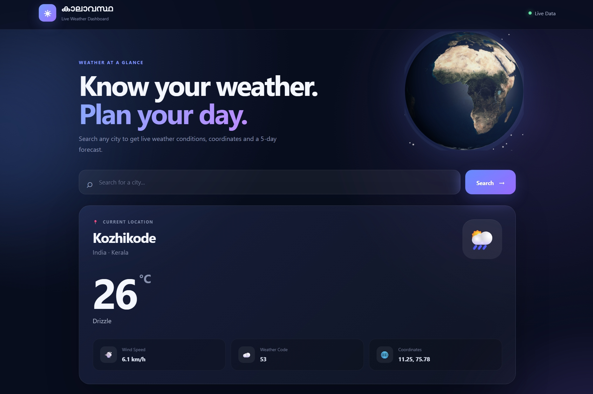
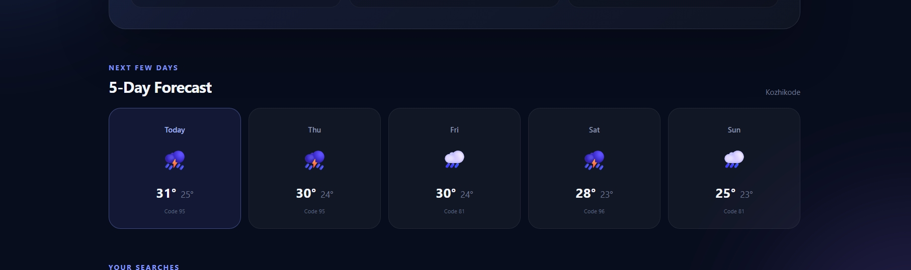
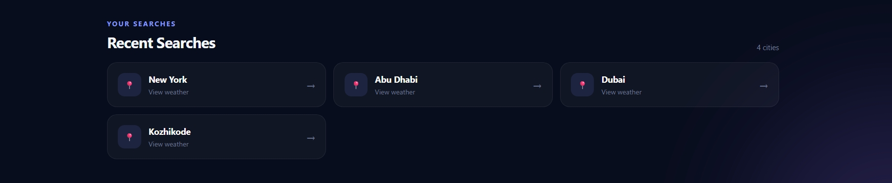

# Weather Dashboard

A responsive weather dashboard built with React.js and the Open-Meteo API. Search for cities, explore current weather conditions, view a five-day forecast, and enjoy an interactive rotating 3D Earth visualization.

## Features

- Search for cities and retrieve weather information
- Display temperature, wind speed, weather conditions, and geographical coordinates
- View a five-day weather forecast
- Keep track of recent searches
- Loading indicators and error handling
- Interactive rotating 3D Earth
- Responsive user interface

## Technologies Used

- React.js
- JavaScript
- HTML5
- CSS3
- Open-Meteo REST API
- Three.js
- React Three Fiber
- Drei

## Getting Started

### Prerequisites

Install Node.js and npm.

### Installation

1. Clone this repository.
2. Open the project folder in your terminal.
3. Install the dependencies:

   ```bash
   npm install
   ```

4. Start the development server:

   ```bash
   npm start
   ```

5. Open http://localhost:3000 in your browser.

## API Integration

The application uses the Open-Meteo Geocoding API to find city coordinates and the Forecast API to retrieve current weather conditions and five-day forecast data.

## Screenshots

## Screenshots







## Live Demo

Coming soon.

## Future Improvements

- Temperature unit conversion
- Enhanced city search
- Additional weather visualizations
- Automated testing